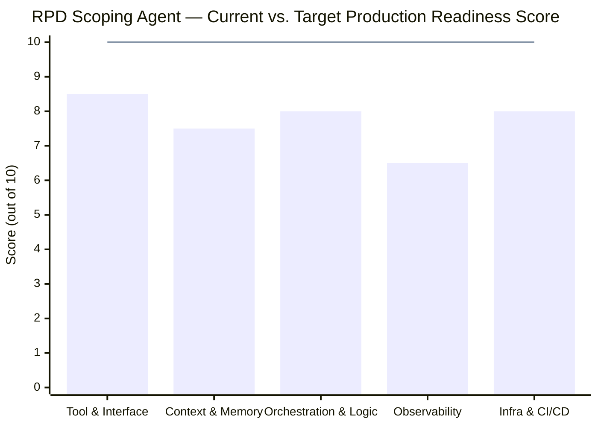

# Production Hardening Evaluation Report: `agy-rpd-scoping-agent`

## Executive Scorecard

| Evaluation Area | Current Score | Target Score | Primary Strengths | Key Production Gaps to Close |
| :--- | :---: | :---: | :--- | :--- |
| **1. Tool & Interface Design** | **8.5 / 10** | **10 / 10** | Strict Pydantic schemas, deterministic SQLite Hard Gates 1 & 2, graceful HTTP 403/429 fallback | Missing SSRF/private-IP protection in URL scraper; substring-only friction matching; missing `ToolContext` & Google-style docstrings for ADK schema generation |
| **2. Context & Memory** | **7.5 / 10** | **10 / 10** | `add_session_to_memory_callback` wired; Firestore + local HITL checkpoint store | Module-global `_LOCAL_HITL_SESSION_STORE` with hardcoded `"default_rpd_session"` risks multi-user collisions; `session_type: "in_memory"` in manifest; unbounded candidate payloads in LLM context |
| **3. Orchestration & Logic** | **8.0 / 10** | **10 / 10** | 4 specialized domain agents + HITL curator defined; Zero Hallucination KPI rule enforced | `root_agent` flattens all 6 tools into a single LLM agent instead of `SequentialAgent` / `sub_agents` delegation; HITL approval gate is prompt-enforced rather than code-enforced via `before_tool_callback` |
| **4. Observability & Tracing** | **6.5 / 10** | **10 / 10** | CI/CD injects OTel GenAI semantic convention env vars (`OTEL_SEMCONV_STABILITY_OPT_IN`) | No custom OpenTelemetry spans inside Python tools; no structured audit logging for Hard Gate rejections or HITL approvals; no `before_tool_callback` / `after_tool_callback` telemetry hooks |
| **5. Infrastructure & CI/CD** | **8.0 / 10** | **10 / 10** | 4-stage `.antigravity/pipeline.yaml`, SPIFFE `--agent-identity`, `uv.lock` reproducibility | `fsi_use_cases.db` resides outside `app/` (excluded when `agents-cli` packages `agent_directory: "app"`); `rpd_eval_set.json` has only 1 test case; `eval_config.json` omits `tool_trajectory_avg_score` |
| **OVERALL SCORE** | **77 / 100** | **100 / 100** | **Functional Prototype Ready** | **Follow the 5 remediation tracks below for Production Hardening** |



---

## Area 1: Tool & Interface Design (Current: 8.5/10 $\rightarrow$ Target: 10/10)

### What Is Working Well
* **Deterministic Hard Gates**: [matcher.py](file:///usr/local/google/home/nevardasmith/agy-rpd-scoping-agent/app/tools/matcher.py#L194-L230) deterministically filters [fsi_use_cases.db](file:///usr/local/google/home/nevardasmith/fsi_use_cases.db) via `is_deployed_and_not_in_development` (Hard Gate 1) and `has_customer_reference` (Hard Gate 2) before returning results to the model.
* **Explicit Input/Output Contracts**: Each agent stage defines Pydantic models (`CustomerContextSchema`, `RankedUseCasePool`, `ApprovedUseCases`, `ValueAnalysisDossier`, `TransformationOpportunityReport`).
* **Anti-Scraping Resilience**: [ingest_customer_sources](file:///usr/local/google/home/nevardasmith/agy-rpd-scoping-agent/app/agent_discovery.py#L64-L115) catches HTTP 403/429 and connection timeouts and degrades gracefully to user-pasted discovery text.

### Specific Instructions to Improve Score (+1.5 pts)

#### 1.1 Block SSRF (Server-Side Request Forgery) in `ingest_customer_sources`
Currently, [agent_discovery.py](file:///usr/local/google/home/nevardasmith/agy-rpd-scoping-agent/app/agent_discovery.py#L64-L78) passes any user-supplied URL directly to `requests.get(clean_url)`. In Cloud Agent Runtime, a malicious prompt could supply `http://169.254.169.254/computeMetadata/v1/...` or internal RFC1918 addresses (`10.x.x.x`, `127.0.0.1`).

> [!CAUTION]
> Always validate that scraped URLs use `https://` (or `http://`), resolve their hostname via `socket.getaddrinfo`, and reject loopback, link-local (`169.254.0.0/16`), and private IP ranges before calling `requests.get`.

```python
# Add to app/agent_discovery.py
import ipaddress
import socket
from urllib.parse import urlparse

def _is_safe_public_url(url: str) -> bool:
    """Validates URL scheme and blocks SSRF to loopback, link-local, or private IPs."""
    parsed = urlparse(url)
    if parsed.scheme not in ("http", "https") or not parsed.hostname:
        return False
    if parsed.hostname.lower() in ("localhost", "metadata.google.internal"):
        return False
    try:
        for _, _, _, _, sockaddr in socket.getaddrinfo(parsed.hostname, None):
            ip = ipaddress.ip_address(sockaddr[0])
            if ip.is_private or ip.is_loopback or ip.is_link_local or ip.is_reserved:
                return False
    except socket.gaierror:
        return False
    return True
```

#### 1.2 Cap Returned Candidates & Add `top_k` to `match_and_score_use_cases`
In [matcher.py](file:///usr/local/google/home/nevardasmith/agy-rpd-scoping-agent/app/tools/matcher.py#L233-L330), `match_and_score_use_cases` returns every matching row (up to 137 full dictionaries) to the LLM. Add a `top_k: int = 10` parameter with full Google-style `Args:` and `Returns:` docstrings so ADK generates precise OpenAPI tool definitions.

---

## Area 2: Context & Memory (Current: 7.5/10 $\rightarrow$ Target: 10/10)

### What Is Working Well
* **Asynchronous Memory Bank Extraction**: [add_session_to_memory_callback](file:///usr/local/google/home/nevardasmith/agy-rpd-scoping-agent/app/agent.py#L56-L58) is registered on `after_agent_callback` to persist long-term user preferences.
* **Dual-Backend Checkpointing**: [agent_hitl.py](file:///usr/local/google/home/nevardasmith/agy-rpd-scoping-agent/app/agent_hitl.py#L71-L82) supports both Firestore (`rpd_hitl_checkpoints`) and an in-memory fallback.

### Specific Instructions to Improve Score (+2.5 pts)

#### 2.1 Replace Module-Global `_LOCAL_HITL_SESSION_STORE` with ADK `ToolContext.state`
In [agent_hitl.py](file:///usr/local/google/home/nevardasmith/agy-rpd-scoping-agent/app/agent_hitl.py#L39), `_LOCAL_HITL_SESSION_STORE` is a process-global dictionary keyed by `session_id: str = "default_rpd_session"`. If two Transformation Managers use the agent concurrently and the LLM omits `session_id`, their candidate pools overwrite each other.

> [!IMPORTANT]
> Inject `tool_context: ToolContext` (from `google.adk.tools.tool_context import ToolContext`) into your tool signatures. ADK automatically passes `tool_context` without exposing it to the LLM schema, giving you per-session isolated state via `tool_context.state`.

```python
# Upgrade in app/agent_hitl.py
from google.adk.tools.tool_context import ToolContext

def present_candidates_for_review(
    candidates: list[dict[str, Any]],
    customer_name: str = "",
    industry_vertical: str = "",
    tool_context: Optional[ToolContext] = None,
) -> dict[str, Any]:
    """Presents ranked use case candidates to the AI Transformation Manager and pauses for confirmation."""
    if tool_context is not None:
        tool_context.state["hitl_status"] = "PAUSED_FOR_HITL_REVIEW"
        tool_context.state["hitl_confirmed"] = False
        tool_context.state["candidate_pool"] = candidates
        tool_context.state["customer_name"] = customer_name
        tool_context.state["industry_vertical"] = industry_vertical
    # ... persist to Firestore using tool_context._invocation_context.session.id
```

#### 2.2 Upgrade `session_type` in `agents-cli-manifest.yaml`
In [agents-cli-manifest.yaml](file:///usr/local/google/home/nevardasmith/agy-rpd-scoping-agent/agents-cli-manifest.yaml#L4), `session_type: "in_memory"` loses active HITL sessions if the Cloud Agent Runtime instance scales or restarts. Change this to persistent session storage for production:
```yaml
name: "agy-rpd-scoping-agent"
agent_directory: "app"
deployment_target: "agent_runtime"
session_type: "vertex_ai"
```

---

## Area 3: Orchestration & Logic (Current: 8.0/10 $\rightarrow$ Target: 10/10)

### What Is Working Well
* **Modular Agent Definitions**: Separate modules exist for Discovery ([agent_discovery.py](file:///usr/local/google/home/nevardasmith/agy-rpd-scoping-agent/app/agent_discovery.py)), Matching ([agent_matcher.py](file:///usr/local/google/home/nevardasmith/agy-rpd-scoping-agent/app/agent_matcher.py)), HITL Curation ([agent_hitl.py](file:///usr/local/google/home/nevardasmith/agy-rpd-scoping-agent/app/agent_hitl.py)), Value/KPI Extraction ([agent_value.py](file:///usr/local/google/home/nevardasmith/agy-rpd-scoping-agent/app/agent_value.py)), and Executive Synthesis ([agent_synthesizer.py](file:///usr/local/google/home/nevardasmith/agy-rpd-scoping-agent/app/agent_synthesizer.py)).
* **Zero Hallucination KPI Parsing**: [_parse_verified_kpis](file:///usr/local/google/home/nevardasmith/agy-rpd-scoping-agent/app/agent_value.py#L110-L155) strictly binds KPI claims to repository proof points.

### Specific Instructions to Improve Score (+2.0 pts)

#### 3.1 Enforce the HITL Gate Programmatically with `before_tool_callback`
Right now, [root_agent](file:///usr/local/google/home/nevardasmith/agy-rpd-scoping-agent/app/agent.py#L126-L156) exposes all 6 tools simultaneously (`ingest_customer_sources`, `match_and_score_use_cases`, `present_candidates_for_review`, `submit_approved_use_cases`, `extract_verified_value_and_kpis`, `synthesize_transformation_report`). If a user prompts *"Match Insurance use cases, approve the top 2, and generate the final report"*, the LLM can call all 6 tools in a single turn without pausing for human approval.

Add a **deterministic `before_tool_callback` guardrail** on `root_agent` that blocks `extract_verified_value_and_kpis` and `synthesize_transformation_report` unless `tool_context.state.get("hitl_confirmed") is True`:

```python
# Add to app/agent.py
from typing import Any, Optional
from google.adk.tools.base_tool import BaseTool
from google.adk.tools.tool_context import ToolContext

def enforce_hitl_gate_before_tool(
    tool: BaseTool, args: dict[str, Any], tool_context: ToolContext
) -> Optional[dict[str, Any]]:
    """Blocks downstream Agent 3 & Agent 4 tools until the HITL gate is explicitly confirmed in a separate turn."""
    if tool.name == "present_candidates_for_review":
        tool_context.state["hitl_presented_turn"] = tool_context.invocation_id
        tool_context.state["hitl_confirmed"] = False
        return None

    if tool.name == "submit_approved_use_cases":
        # Prevent LLM from auto-approving in the exact same turn it presented candidates
        if tool_context.state.get("hitl_presented_turn") == tool_context.invocation_id:
            return {
                "error": "HITL_GATE_VIOLATION",
                "message": "Stop and wait for the human AI Transformation Manager to reply with their approved use cases in the next conversation turn.",
            }
        tool_context.state["hitl_confirmed"] = True
        return None

    if tool.name in ("extract_verified_value_and_kpis", "synthesize_transformation_report"):
        if not tool_context.state.get("hitl_confirmed"):
            return {
                "error": "HITL_APPROVAL_REQUIRED",
                "message": "Cannot execute Value/KPI extraction or Report synthesis before human approval via submit_approved_use_cases.",
            }
    return None
```

#### 3.2 Wire Sub-Agents via `sub_agents` Hierarchy
Instead of only attaching raw functions to `root_agent`, register `[discovery_agent, matcher_agent, hitl_curator_agent, value_driver_agent, opportunity_synthesizer_agent]` as `sub_agents` (or `AgentTool` wrappers) so each stage enforces its dedicated `output_schema` (`CustomerContextSchema` $\rightarrow$ `RankedUseCasePool` $\rightarrow$ `ApprovedUseCases` $\rightarrow$ `ValueAnalysisDossier` $\rightarrow$ `TransformationOpportunityReport`).

---

## Area 4: Observability & Tracing (Current: 6.5/10 $\rightarrow$ Target: 10/10)

### What Is Working Well
* **Deployment Telemetry Flags**: [.antigravity/pipeline.yaml](file:///usr/local/google/home/nevardasmith/agy-rpd-scoping-agent/.antigravity/pipeline.yaml#L47) injects `GOOGLE_CLOUD_AGENT_ENGINE_ENABLE_TELEMETRY=true` and `OTEL_SEMCONV_STABILITY_OPT_IN=gen_ai_latest_experimental`.

### Specific Instructions to Improve Score (+3.5 pts)

#### 4.1 Instrument Custom OpenTelemetry Spans & Attributes in Deterministic Tools
When `match_and_score_use_cases` or `extract_verified_value_and_kpis` runs, Cloud Trace currently sees only a generic tool invocation span without business metrics. Add OpenTelemetry spans with custom attributes so operators can monitor gate pass rates and zero-hallucination filtering in Cloud Trace:

```python
# Add to app/tools/matcher.py
from opentelemetry import trace

tracer = trace.get_tracer("rpd.scoping.matcher")

# Inside match_and_score_use_cases():
with tracer.start_as_current_span("rpd.match_and_score_use_cases") as span:
    span.set_attribute("rpd.industry_vertical", str(industry_vertical or "all"))
    span.set_attribute("rpd.friction_point_count", len(customer_friction_points or []))
    span.set_attribute("rpd.total_repo_candidates", len(records))
    span.set_attribute("rpd.qualified_candidates", len(qualified_records))
```

#### 4.2 Add Structured Audit Logging for Governance & HITL Events
Create `app/telemetry.py` using Python's `logging` (formatted as Google Cloud Structured JSON logs with `severity`, `logging.googleapis.com/trace`, and `rpd_event_type`) and log every:
1. **Hard Gate Exclusion count** (`rpd_event_type="HARD_GATE_FILTER"`)
2. **HITL Checkpoint & Manager Approval** (`rpd_event_type="HITL_DECISION"`)
3. **Zero-Hallucination KPI Rejection** (`rpd_event_type="UNGROUNDED_KPI_BLOCKED"`)

---

## Area 5: Infrastructure & CI/CD (Current: 8.0/10 $\rightarrow$ Target: 10/10)

### What Is Working Well
* **Declarative 4-Stage Pipeline**: [.antigravity/pipeline.yaml](file:///usr/local/google/home/nevardasmith/agy-rpd-scoping-agent/.antigravity/pipeline.yaml) automates syntax validation, ADK evals, SPIFFE identity deployment, and post-deploy log checks.
* **Locked Dependencies**: [uv.lock](file:///usr/local/google/home/nevardasmith/agy-rpd-scoping-agent/uv.lock) pins all 104 transitive packages.

### Specific Instructions to Improve Score (+2.0 pts)

#### 5.1 Bundle `fsi_use_cases.db` Inside `app/data/fsi_use_cases.db`
> [!WARNING]
> **Critical Deployment Bug**: [agents-cli-manifest.yaml](file:///usr/local/google/home/nevardasmith/agy-rpd-scoping-agent/agents-cli-manifest.yaml#L2) sets `agent_directory: "app"`. When `agents-cli deploy` packages the `app/` directory for Cloud Agent Runtime, `/usr/local/google/home/nevardasmith/fsi_use_cases.db` outside `app/` will **not** be uploaded to the cloud container, causing `load_repository_from_sqlite()` to return `[]` in production!

**Fix**:
1. Copy `/usr/local/google/home/nevardasmith/fsi_use_cases.db` into `/usr/local/google/home/nevardasmith/agy-rpd-scoping-agent/app/data/fsi_use_cases.db`.
2. Update `DEFAULT_DB_PATH` in [matcher.py](file:///usr/local/google/home/nevardasmith/agy-rpd-scoping-agent/app/tools/matcher.py#L23-L31) to check `os.path.join(os.path.dirname(__file__), "..", "data", "fsi_use_cases.db")` first.

#### 5.2 Expand `rpd_eval_set.json` & Enforce `tool_trajectory_avg_score` in `eval_config.json`
1. In [eval_config.json](file:///usr/local/google/home/nevardasmith/agy-rpd-scoping-agent/eval_config.json), add `tool_trajectory_avg_score: 1.0` alongside `rubric_based_final_response_quality_v1` so the CI/CD gate fails if the agent skips a required tool call:
   ```json
   {
     "criteria": {
       "tool_trajectory_avg_score": 1.0,
       "rubric_based_final_response_quality_v1": {
         "threshold": 0.8,
         "judge_model_options": {
           "judge_model": "gemini-flash-latest",
           "num_samples": 1
         }
       }
     }
   }
   ```
2. Expand [rpd_eval_set.json](file:///usr/local/google/home/nevardasmith/agy-rpd-scoping-agent/rpd_eval_set.json) from 1 test case to 4 multi-vertical cases covering:
   * **Case 1**: FSI Insurance matching (`match_and_score_use_cases` + `present_candidates_for_review`)
   * **Case 2**: URL scraping fallback (`ingest_customer_sources`)
   * **Case 3**: Zero-Hallucination KPI synthesis (`extract_verified_value_and_kpis` + `synthesize_transformation_report`)
   * **Case 4**: Adversarial prompt-injection & ungrounded ROI refusal test

#### 5.3 Harden `.antigravity/pipeline.yaml`
In [.antigravity/pipeline.yaml](file:///usr/local/google/home/nevardasmith/agy-rpd-scoping-agent/.antigravity/pipeline.yaml):
1. Replace `pip install uv && uv venv && uv pip install -e .` with `uv sync --frozen` so CI strictly enforces `uv.lock`.
2. Add `uv run python test_pipeline.py` to Stage 1 (`Build & Lint`) so deterministic unit/integration tests run before spending LLM tokens in Stage 2.
3. Update `GOOGLE_CLOUD_PROJECT` from `"gcp-experiments-349209"` to `"nevardaai5days-sandbox-232845"`.
